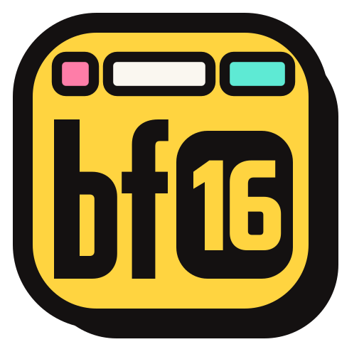

# bf16.ai

**[Uncensored LLM API](https://bf16.ai) for coding agents and personal agents.**

We host open-weight models such as DeepSeek and GLM with refusals removed from the weights, behind OpenAI- and Anthropic-compatible endpoints. Your agent gets an answer instead of a refusal, a lecture or watered-down code.

- **Drop-in API.** Keep the OpenAI or Anthropic SDK you already use; change the base URL and key. See the [API docs](https://bf16.ai/docs).
- **Coding agents.** Run Claude Code, Codex, OpenCode or Pi on [uncensored models](https://bf16.ai/models).
- **Personal agents.** Works with OpenClaw, Hermes Agent and OpenMausBot.
- **1M context.** Long agent sessions and large repos fit.
- **Pay as you go.** Prepaid USD credits, no subscription. See [pricing](https://bf16.ai/pricing).

**Links:** [Website](https://bf16.ai) · [Docs](https://bf16.ai/docs) · [Models](https://bf16.ai/models) · [Pricing](https://bf16.ai/pricing) · [Playground](https://bf16.ai/playground) · [Blog](https://bf16.ai/blog)
